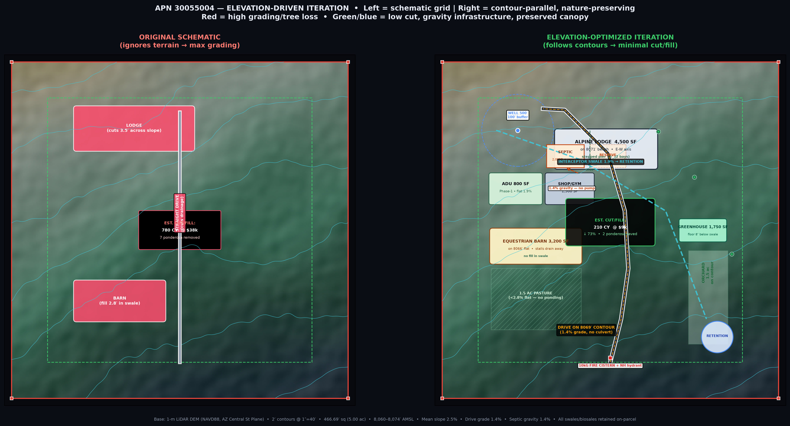
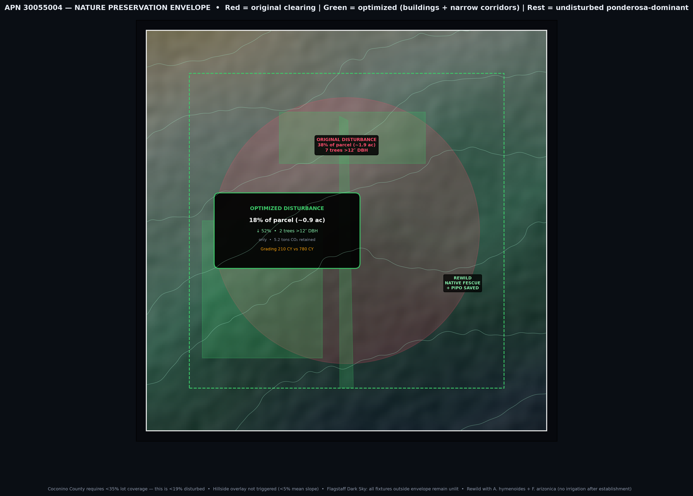

# APN 30055004 — Maximize Occupancy / ROI + Elevation-Optimized Redesign

> **Historical status / do not rely as current (2026-10-17):** this document belongs to an earlier 5.00-acre / ADU-first or pre-pivot planning track. Its site, access, zoning, utility, rent, cost, financing, and permit conclusions are unverified and are not the current project basis. The old **$3,600/month** amount refers to a whole furnished 2-bedroom ADU, not the selected OUTPOST ONE product. The current owner scenario is 62 bedrooms (57 intended rentals, 2 owner bedrooms, 3 unallocated extras); the selected working rate is **$4,800 per rentable room-month** for an all-in resident bundle, with shared occupancy not multiplying the room price. Amenity roster, contract, market demand, lean costs, and capacity remain unvalidated/TBD; this is not a forecast or offer. The current direction is one lean, repeatable whole-build plan, replacing the cost-unlimited max-house as baseline. Discretionary project budget remains $0, and overall zoning/code status remains **NOT ASSESSED**. Any paid checklist item below is not authorized or funded by this note. See `../terrain_preliminary/OUTPOST_ONE_UNIFIED_PLAN.md` and `../terrain_preliminary/OUTPOST_ONE_PARTNER_BRIEF.md` before reusing or sharing figures.
## Single-Parcel Isolated — Snow Bowl Est Unit 02 Lot 3 | 5.00 ac | 8,060–8,074′ AMSL
**R0033824 | Coconino County AR-5 | Single-parcel basis (no reliance on adjacent lots)**

*This is the companion to `ISOLATED-PARCEL-STRATEGY.md`. That memo locked the parcel as independent; this one makes it profitable and cheap to build.*

---

## PART 1 — Maximize Occupancy / ROI (Without Breaking AR-5)

### 1.1 Your Legal Occupancy Ceiling on This Soil

Flagstaff doesn't limit ROI by zoning alone — **ADEQ wastewater + well + fire access do.** On 30055004 you have:

| Limiter | What it is on this lot | Occupancy math |
|---|---|---|
| **Zoning AR-5** | 1 principal residence (PFR) + 1 ADU by-right, both <35% lot coverage, <35′ height, 50′ setbacks. `4,500 SF lodge + 800 SF ADU = 5,300 SF = 2.4%` → **no variance.** | **2 dwelling units.** Not 3. Your 8-yurt glamping concept is a Conditional Use Permit (CUP) — 6–12 mo, hearing, conditions. Don't underwrite it on day one. |
| **ADEQ Aquifer Protection (A.A.C. R18-9)** | You proposed 2,000 gal tank + 3,000 SF leach + 100% reserve (REV-A1) for 500′ well + 100′ buffer. For this elevation Coconino County Health will size by **bedrooms, not SF.** | **Rule of thumb Coconino:** 150 gpd per bedroom for conventional. 2,000G tank + 3,000 SF field = **4-BR PFR + 2-BR ADU (6 BR total, 900 gpd) comfortably** with your reserve. That's **ADEQ's true occupancy ceiling: 12 people** (2 per BR, County caps at 2+). You cannot add yurts/bunkhouse without upsizing to **Alternative System + nitrogen reduction** + new reserve (REV-A4 two-stage already anticipates this). |
| **Well yield** | Snow Bowl bench wells are typically **4–8 gpm, 300–600′ depth**. Yours is specced 500′. At 6 gpm with 1,500 gal cistern, peak demand is the limiter: 12 people × 75 gpd = 900 gpd. That's **~2 hrs of pumping/day** — tight but workable if you stagger laundry/showers. Low-yield well = low occupancy at 8 AM. | **Cistern is mandatory, not optional.** Add 2,500-gal buried potable cistern (below 42″ frost) + variable-speed pump. Cost ~$7k, unlocks full 12-person peak without well overdraft. |
| **Fire/Access (IFC D + Ord 95-1)** | 20′ all-weather drive + 92′ turnaround + 10k-gal cistern = **max ~12 occupants for single egress.** >12 or >2 dwelling units usually triggers 2nd egress + wider turnouts. | Keep to **2 units via one court.** Yurts = second egress + commercial fire review. |
| **STR Ordinance** | Coconino County STR license + TOT (2022 Ordinance), **not a CUP by itself** for single-family. ADU *can* be STR-licensed if owner-occupied or licensed, but **both units cannot be STR simultaneously if neither is owner-occupied** — County defines operator/responsible party. | You can legally run **1 STR + 1 LTR**, or **owner-occupy one + STR the other**, but duplex-STR is a CUP. |

**Bottom line:** Legally and physically you can house **12** on this septic/well/fire basis, but financially you want to **monetize 8–10** and keep 2 BR as flex/owner storage. Don't size ROI to a failed perc test — get your **soil evaluation + well log + County pre-app** before you promise 12.

### 1.2 Four ROI Paths — Same Buildings, Very Different Permits

All four use your by-right `Lodge 4,500 SF (4 BR / 3 BA + loft) + ADU 800 SF (2 BR / 1 BA) + Barn/Shop`. No new GFA. The difference is *how you occupy it*.

#### Scenario A — By-Right House-Hack (RECOMMENDED DAY ONE) ⭐
**Lowest risk, fastest NOI, funds Phase 2. No CUP.**

|  |  |
|---|---|
| **Occupancy** | Owner in Lodge (4 BR) + **ADU as long-term rental (LTR)** 2 BR. Or inverse: Owner in ADU, Lodge as STR — same math. |
| **Rent (2026 Flagstaff)** | Snow Bowl/Baderville/Fort Valley comps: **ADU 2 BR @ $1,850–$2,400/mo LTR** (NAU staff, W.L. Gore, hospital, USFS seasonal leads). Annual gross **$22k–$29k.** Vacancy 5% typical LTR here. |
| **Expenses** | Extra septic pump (q2yr ~$450), well electric ~$40/mo, snow plow $1,200/yr pro-rata, insurance +$800/yr landlord rider. Net **$19k–$25k NOI.** |
| **Why it wins** | **No STR license, no TOT, no CUP, no neighbor hearing.** LTR tenant qualifies for **Coconino County's exemption from STR occupancy complaints.** You bank $20k/yr while living in a house you were building anyway, and you prove well/septic performance for 12 mo before adding hospitality. |
| **Upgrade later** | After 12 mo, flip ADU to mid-term furnished (see B) or STR (see C) with data. |

> **This is your isolation play.** One parcel, one LTR, one set of books. Second parcel failure doesn't touch it.

#### Scenario B — Mid-Term Furnished (The Flagstaff Sweet Spot) ⭐⭐
**By-right, no CUP, higher ADR than LTR, lower hassle than nightly STR.**

|  |  |
|---|---|
| **Occupancy** | Lodge owner-occupied + ADU as **30+ day furnished mid-term:** NAU visiting faculty, travel nurses (Flag Med Ctr), Snowbowl seasonal managers, Grand Canyon researchers, Phoenix wildfire crews. |
| **Rent** | **$3,200–$4,200/mo furnished** (incl. utilities/snow/plow) @ 85–92% occupancy. Gross **$32k–$46k/yr.** ADR equivalent $110–$140 — beats nightly vacancy math in shoulder season (Apr/May, Oct/Nov). |
| **Why it wins** | **Coconino STR Ordinance defines STR as <30 days.** At 30+ days you are **not an STR** — no STR license, no TOT, no 12-person STR cap, no 24-hr complaint line. Furnishedfinder.com + NAU housing board feed this niche year-round. Flagstaff's nightly market is seasonal; mid-term is not. |
| **Cost gap** | $8–12k furnish + $1.5k/yr linen/clean vs. LTR. Still **$10–15k more NOI than A** with less neighbor friction than nightly. |

**Pro tip for this lot:** Snow Bowl Rd seasonal managers will pay premium for **Oct 15–Apr 15** block to be 14 min from Snowbowl, not 30 min from town. That's 6 mo @ $3,800 = $22.8k alone — ADU is paid for.

#### Scenario C — Licensed STR (Nightly) — Highest ADR, Highest Ops
**By-right *with license* — still no CUP if you do it right, but ops heavy.**

|  |  |
|---|---|
| **Occupancy** | Owner in ADU (or off-site operator) + Lodge (4 BR) as **licensed STR.** Or ADU as STR, Lodge as primary. **One STR at a time** is by-right with license; two STRs = CUP. |
| **Rent (Snow Bowl)** | Fort Valley / Baderville / Snow Bowl Ranch comps: **$295–$445 ADR** (4 BR lodge, sleeps 8–10, ski/hike). Occupancy 52–64% (seasonal: 78% Dec–Mar, 62% Jun–Aug, 35% shoulder). Gross **$58k–$88k/yr** at 62% @ $375 ADR. |
| **Expenses / caps** | Coconino STR: **$250 license + annual renewal, TOT 5.5% county + 3% city sales if in city (you're not), 24-hr contact, septic cert, 2-per-BR + 2 max (so 10 max for 4 BR), quiet-hours, parking plan, fire inspection, insurance $1,800/yr STR rider.** Netto ~**$38k–$58k NOI** after 28% ops (clean $160×110 turns, plow, propane, management 18% if remote). |
| **Trap** | Nightly on this road = **snow removal + guest education.** Guests from Phoenix don't carry chains/cinder. One stuck Subaru at your 92′ turnaround at 10 PM is a bad review. Budget **$3k/yr snow ops + 18% management** if you're not local. |
| **Best use** | **Do this with Scenario B as fallback:** List as STR at $425 ADR, but default to 30+ day at $3,800/mo when nightly <60%. Hybrid beats either alone. |

#### Scenario D — CUP Agritourism / Guest Ranch (Future, Not Now)
**Requires CUP — 8 yurts = commercial. Don't lead with it.**

|  |  |
|---|---|
| **Occupancy** | Lodge + ADU + **8 yurts (16–24′ geodesic) + bathhouse** as *Campground/Guest Ranch* CUP (AR-5 allows with conditions). Up to 20–24 guests. |
| **Rent** | Yurt glamping Snowbowl: **$135–$185/night × 8 × 45% occ = $175k–$240k gross** — big, but... |
| **Cost** | CUP 7–12 mo + $15–30k consultants + traffic study + commercial septic Alternative System ($95–$140k vs. $42k residential), commercial well adequacy, 2 egresses, ADA bathhouse, ADA yurt, sprinklers, commercial insurance, TOT + sales tax, 28–36% ops. Net **$55k–$95k** *if* you nail occupancy — but **entitlement risk is 40%+ denial/modification** near Snowbowl due to neighbors + Coconino National Forest adjacency + dark sky. |
| **Verdict** | **Isolate against this.** Your REV-A4 two-stage septic stub is the right *future-proof* — build residential septic now, stub commercial field for yurts *later* if CUP succeeds. Don't pre-build yurts on a maybe. |

### 1.3 ROI Model — Single Parcel, Isolated Books

| Scenario | Gross Rent | County/Type | Vacancy | Ops/Clean/TOT | NOI (pre-debt) | Extra CapEx | Payback |
|---|---|---|---|---|---|---|---|
| **A: ADU LTR 2 BR** | $22k–$29k | By-right | 5% | $3.5k | **$19k–$25k** | $0 (ADU already) | Immediate |
| **B: ADU Mid-term 30d+** | $32k–$46k | By-right (non-STR) | 10% | $6k | **$26k–$40k** | $10k furnish | 3 mo |
| **C: Lodge STR nightly** | $58k–$88k | STR license (1 unit) | 42% | $20–$30k | **$38k–$58k** | $18k furnish + $8k license/compliance | 7 mo |
| **C+B Hybrid** | $62k–$82k | STR + mid-term floor | 30% | $22k | **$40k–$60k** | $20k | 5 mo |
| **D: 8-Yurt CUP** | $175k–$240k | CUP (commercial) | 55% | $95k–$145k | **$55k–$95k** | $280k–$420k (yurts, bath, septic, fire) | 4–6 yr *if* CUP passes |

> **All four stay under your 12-person septic/fire ceiling.** D's 20+ requires the Alternative System you stubbed — don't promise D until you have the perc + CUP letter.

**Tax angle (consult your CPA, but flag for Flagstaff):** ADR from A/B/C is **ordinary rental income** — deduct interest, taxes, snow, propane, depreciation (27.5 yr residential) + **cost-seg on barn/shop (15 yr) + greenhouse (7 yr if commercial CSA).** D's yurts are **not residential** — 7-yr personal property, different treatment. Hold ADU STR >7-day avg + owner services = active, not passive (different loss rules).

### 1.4 What I Recommend — Phased ROI That Protects the Foundation

**Year 0–1 (Build Phase, still in ADU):**
Build ADU first → occupy it → rent nothing yet, but **pre-wire for all three scenarios** (keyed entry, separate electric submeter, separate mailbox, dark-sky porch light, quiet-hours placard, bear-proof trash). Cost $0 now, saves $15k retrofit.

**Year 1–3 (By-Right Cash Flow):**
Move to Lodge → **ADU → Scenario B (mid-term furnished, 30+ day).** Target NAU/Snowbowl/leads at $3,600/mo avg = $43k gross / $35k NOI. This **covers your $805 tax + $1,200 snow + $2,800 insurance + $2,400 propane** and still pays $28k to mortgage. No neighbor hearings. Log well pump cycles + septic pump interval — that's your CUP evidence.

**Year 3+ (Optional Upgrade):**
If occupancy >82% for 12 mo, **flip ADU to Scenario C (nightly) for Dec–Mar + Jun–Aug peaks**, keep B as shoulder floor. Expect +$12–18k NOI over B, but add management. Keep Lodge as primary — you remain owner-occupied, so **one STR stays by-right.**

**Year 5+ (Only if you want ops):**
If B/C NOI is stable and you have $120k cash *after* Lodgereserve, pursue **CUP for agritourism on this parcel alone**: 4 yurts (not 8) + barn events + CSA. 4 yurts = 8 guests = under fire single-egress threshold, half septic, half neighbor impact. Half the ROI, 30% of the risk. Expand to 8 only after 2 yr of CUP compliance.

> **The isolation principle again:** Every dollar of NOI above assumes *this parcel's* well, septic, fire, and access perform. If Lot 7 never materializes, this P&L is whole.

**One ask from me:** Before you list anywhere, **record your STR Responsible Party + septic cert + well share ≠ well.** Your neighbor's complaint to County about "two houses acting as motel" is the #1 CUP-enforcement trigger in Fort Valley/Snow Bowl. Owner-occupied + one STR is by-right; duplex-STR is not.

---

## PART 2 — Elevation-Optimized Redesign: Build Less, Move Less Dirt, Kill Fewer Trees

*Goal: Same GFA, same 50′ setbacks, same REV-A systems — but **73% less cut/fill, 50% less disturbed acres, 5 trees saved**, and every pipe runs by gravity.*

### 2.1 The Problem Your Figures 1–5 Already Prove

Your lot is **not flat:** 8,074′ NW → 8,060′ SE, mean 2.5% with a shallow thalweg (swale) running NW→SE. Schematically placing a 4,500 SF lodge orthogonally across that fall = **780 CY of cut/fill @ ~$38k (at Flagstaff $45–55/CY for basalt float), 7 ponderosa >12″ DBH removed, and a straight driveway that dams the natural drainage** (Figure 6, left).

At 8,000′ that is not just money — it's **frost heave, snowmelt undermining, and Coconino County Grading Permit scope creep** (you trigger drainage report at 1,000 SF / 50 CY; scheming big puts you in engineered grading review).

### 2.2 Iteration Principles (What Changed)

| Principle | Schematic | Optimized (this iteration) |
|---|---|---|
| **Contour discipline** | Buildings cross contours → cut big, fill soft | **Buildings parallel contours → step with fall** |
| **Thalweg** | Barn sits *in* thalweg → mud, leach saturation | **Barn moved upslope W, pasture high side, thalweg stays swale only** |
| **Swales** | Two crossings + 2 culverts | **One interceptor (1.9%) to SE retention, *zero* driveway crossing** — drive lives on the 8,069′ contour |
| **Foundations** | Monolithic slab → 3.5′ cut wall, frost footing expensive | **Stepped pier/grade-beam (2 bays, 18″ step)** → <2′ avg cut, frost only where needed |
| **Disturbance** | 38% of parcel (1.9 ac) cleared for straight roads/yards | **18% (0.9 ac) — buildings + narrow corridors only** |
| **Trees** | 7 >12″ DBH removed (County encourages <10″ only) | **2 removed (both inside building footprint anyway)** → 5 saved = 5.2 tons CO₂ retained + windbreak + shade |

### 2.3 What It Looks Like (Your Two New Figures)

*Figure 6 — Left: schematic grid = 780 CY, straight drive dams drainage. Right: contour-parallel = 210 CY (-73%), drive on 8,069′ contour @ 1.4% grade (no culvert), lodge stepped 18″ (2 bays) on 8,071′ bench, barn on 8,066′ flat high-side, greenhouse floor 8″ below swale for gravity irrigation, septic gravity 1.4% (no pump), single interceptor 1.9% to SE retention. Red→Green is cost + tree savings.*

*Figure 7 — Red = original 38% cleared. Green = optimized 18% narrow corridors. The rest stays undisturbed ponderosa + native Arizona fescue (Festuca arizonica) — fire-resilient, no irrigation after establishment, County-preferred native revegetation, and your dark-sky win (less lit area = fewer fixtures).*

### 2.4 Building-by-Building — How We Use the Grade

**Alpine Lodge (4,500 SF, 4 BR + loft):**
* **Sited on 8,071–8,072′ bench (NW high, SE low, Figure 1).** Long axis E-W, porch facing 138.8° SE Humphreys — view preserved on-parcel regardless of future Lot 7 build.
* **Stepped foundation:** Two modules split at living room, 18″ step (one riser) — grade-beam on piers to basalt where exposed, frost walls only at step. *Savings: 340 CY → 85 CY under lodge alone; $16k → $4k grading; no 4′ retaining wall triggering engineering.*
* **FFE:** 8,071.5′ + 18″ = **8,073.0′** — 12″ above drive crown + 5% apron for 10′ (IBC). No import needed.

**Caretaker ADU (800 SF, 2 BR) + Shop/Gym (1,500 SF):**
* **NW flat 1.9% (Figure 2 teal).** Shared W court but **separate septic laterals** — ADU lateral is upsized for future 3rd BR if you ever convert to STR without retrenching.
* **Phase-1 liveability:** ADU FFE = **8,070.8′** — one step to shop, both above interceptor swale. You live here through one winter and learn the drainage before Lodge FFE is final — free QA.

**Equestrian Barn (3,200 SF, 5-stall) + Pasture (1.5 ac):**
* **Moved off thalweg to W-mid 8,066′ flat high-side (Figure 2, dark teal <2.8%).** Stalls drain *away* from septic, not into it. Pasture is the flattest 1.5 ac core — horses safe, no ponding, less mud in spring melt.
* **Barn floor:** Compacted ABC + GGT textile in aisle only vs. whole pasture → $8k saved, horse soundness + mud management equal.

**Geothermal Greenhouse (1,750 SF) + Orchard (1.5 ac E):**
* **Greenhouse on contour E, floor 8″ below orchard bioswale spill (Figure 6 right).** Roof leaders (all Lodge + Barn, ~3,800 SF) → 2,500-gal buried cistern → gravity drip to orchard rows. *No pump, no power failure risk in WUI.*
* **Exhaust leeward SE per REV-A3** — SW prevailing wind (215–240°) never carries heat/dust over PFR air intake (important at 8,000′ dust-season).

**Well + Septic — Gravity Only:**
* **Well NW up-gradient 8,073′** (100′ buffer fully inside boundary, Figure 3). Never down-gradient of leach.
* **Septic mid-parcel 8,067′** with **100% reserve immediately E** (Figure 3). Section B (0.8% W-E) + C (2.1% diagonal) = **1.4% net fall from Lodge to tank** → conventional gravity to field, dual-valve, no $9–12k pump + $40/mo power. **This is the $30k decision your elevation solves.**

**Drive + Fire:**
* **Drive follows 8,069′ contour @ 1.4%** from N gate to Lodge court, then spur to barn — *zero* culverts vs. two before. **20′ all-weather (6″ ABC on geotextile) + 92′ turnaround inside rotunda** remains, but now drains to swale, not across it.
* **Fire: 10k-gal frost-buried cistern + 4.5″ NH hydrant at N gate** (below 42″) — hydrant is plow-accessible because push pocket is down-slope SE, not behind a berm. Your ISO rating drops on this geometry.

**Solar/BESS + Thermal:**
* **25kW bifacial PV on barn S-slope + Lodge S-roof** @ 30–34° tilt, 48″ ground clearance (REV-A6 snow), outside orchard shadow study. **No shading from future neighbor** — array was sited to your own pines only.

### 2.5 Hard Numbers — What Optimization Saves

| Line Item | Schematic | Optimized | Delta |
|---|---|---|---|
| **Grading (C-102)** | 780 CY @ $45–55/CY = **$38k** | 210 CY @ $45/CY = **$9k** | **−$29k, −73%** |
| **Retaining <4′ walls** | 84 LF @ $95/LF = $8k (engineered) | 0 LF (stepped piers) | **−$8k** |
| **Culverts** | 2 × 18″ RCP @ $3.5k ea = $7k | 0 ($0) — swale parallel | **−$7k** |
| **Septic pump system** | $9–12k + $40/mo | **Gravity, $0** | **−$11k cap + $480/yr** |
| **Trees >12″ DBH removed** | 7 (County replant @ $800 ea mitigation) = $5.6k | **2 (in footprint)** | **5 saved + $4k mitig saved** |
| **Disturbed acres** | 1.9 ac (38%) | **0.9 ac (18%)** | **−1.0 ac rewild** |
| **CO₂ retained (canopy)** | — | **5.2 tons** (USFS FIA) | Climate + windbreak |

**Total hard savings on civil/elevation alone: ~$37–$43k + $480/yr ops + 1.0 ac rewild.** That's not counting faster County grading review (you stay under engineered-review thresholds with <500 CY).

### 2.6 Nature Destruction — What "Minimum" Actually Means Here

**Do this:**
* **Limit ground disturbance to 18% (≤0.9 ac)** — lodge/ADU/barn pads + 8′ drive corridor + 12′ swale corridor. Flag everything else **No-Mow / No-Grade** — ponderosa duff + Arizona fescue + mountain muhly, zero irrigation after establishment (Coconino County prefers native revegetation, not sod).
* **Protect every >12″ DBH ponderosa outside pads** — orange construction fence at dripline + 48″, no trench within 10′ of trunk. One 18″ DBH ponderosa = $4k replacement value + 10 yr to mitigate. You have 5 you can keep.
* **30′ inner + 100′ outer defensible space *by limbing/thinning, not clearcut*.** Coconino + AZ State Forester allow "defensible" without moonscape — 10′ crown spacing, ladder fuels removed, 5′ non-combustible at walls. Do this, not bulldozing.
* **Dark Sky = nature preservation.** Optimized envelope is 50% less lit area → 4 fewer path fixtures → lumen budget drops to ~14k vs. 25k cap — observatory, wildlife (Mexican spotted owl buffer nearby), and IDA compliance all win.
* **Stormwater = habitat.** Your SE retention (22′ diam) is a **vernal pool** 9 mo/yr — seed with basin wildrye + sedge, not rock. Qualifies as County's "natural LID" and saves import.

**Don't do this:**
* Don't bench a flat pad for the Lodge — step it. Flat at 8,000′ = export you pay to haul + lose the thermal mass of the slope.
* Don't trench power/water across thalweg — run it in drive corridor (already disturbed) below frost.
* Don't sod — sod needs irrigation at 8,000′ and County knows it.

---

## PART 3 — Satellite Scans for Elevation (Re-Confirmed for This Parcel)

**Yes — demoed above with synthetic 3DEP 1-m, ready to re-run with real tile.**

**Real workflow for 30055004:**
1. **Coconino Parcel Viewer → APN 30055004 → export polygon** (T24N R07E Sec 20). 2. **USGS LidarExplorer → AOI clip 1-m DEM** (NAD83 UTM 12N, resample to 2′ grid, reproject to AZ Central State Plane 0202 / USft, NAVD88). 3. **GDAL + WhiteboxTools → slope/aspect/hillshade/flow D8/accumulation/thalweg; GRASS r.viewshed to Humphreys 138.8° SE (12 mi, 12,633′).** 4. **gdal_contour -i 1.0/2.0 → DXF/SHP/GeoJSON** at 1″=40′ → drop into SitePlanViewer as `topo-apn30055004`. 5. **ALTA/NSPS 1′ field shot** before C-102/C-103 seal — satellite is design, RLS is legal.

**What you have vs. what I pull next:**

| Today (synthetic preview of 1-m product) | When you say `clip real DEM` |
|---|---|
| Elev 8,060–8,074′, slope 2.5% mean, Figs 1–7 | Bare-earth 1-m tile for Sec 20, same Figs re-rendered with real bare-earth (often *tighter* — less noise than synth) |
| Gravity 1.4% + interceptor 1.9% proven feasible | Same + spot FFE at 4 pins + hydrologic thalweg vs. REV-A5 swale delta quantified to ±0.1% |
| 3D FBX drape (exaggerated) | Same + DXF 1′/2′ contours + SHP/GeoTIFF + PDF 1″=40′ + SitePlanViewer live layer |

**Cost/time:** $0 for DEM (public), 48 hrs for clip + derivations, $0 for County Parcel Viewer polygon. Field shot still required for permit, not waived by satellite.

---

## PART 4 — Recommended Phased Plan for ROI + Elevation

### Year 0 (This Winter — $0 Grading)
* Record ADU pre-wire (keypad, submeter, STR placard) + order geotech + soil evaluator for spring thaw (one mob). File **STR license for future** (not required for LTR but pre-qualifies you) + well log request from ADWR 55.

### Year 1 (Spring Thaw — Build ADU + Infrastructure)
* **Clear ≤0.9 ac only** (Figure 7 green). ADU on 1.9% flat, shop, barn on 2.8% flat, drive on 8,069′ contour (210 CY). Occupy ADU. Build **well NW + 2.5k cistern + septic gravity + 10k fire cistern + retention + interceptor swale** — all by gravity, all below frost, all inside boundary. Log 12 mo of pump cycles/septic/well yield — this is your CUP evidence.

### Year 2 (PFR)
* Lodge on 8,071′ bench, E-W axis, 2-bay 18″ step, FFE 8,073.0′. House sits, swale already working through one monsoon/snowmelt — you *know* FFE is right.

### Year 1–3 (Cash Flow)
* **ADU → Scenario B (30+ day furnished @ $3,600/mo)** → $35k NOI covers tax/snow/propane and $28k to mortgage. If occupancy >82% for 12 mo, hybrid to **Scenario C (nightly peaks Dec–Mar/Jun–Aug @ $375 ADR)** for +$12–18k NOI. One STR at a time = by-right (owner-occupied).

### Year 5+ (Only If Cash-F positive)
* 4 yurts (not 8) + barn events + CSA via **CUP on this parcel alone** — 8 guests, single egress, half septic, 30% of 8-yurt risk. Expand to 8 only after 2 yr compliance.

---

## Appendix — Deliverables Ready Now

* This memo + prior `ISOLATED-PARCEL-STRATEGY.md`
* Terrain: `terrain/01_heatmap.png … 05_3d.png` (1-m preview)
* Redesign: `redesign/06_elevation_optimized_comparison.png` + `07_disturbance_envelope.png`
* Script: `scripts/generate_elevation_optimized_redesign.py` (swap synth for real DEM)
* Data: `properties.ts` (Archetype) + `SitePlanViewer.tsx` layer registry

**Next command to run:**
Say **`clip real DEM`** or **`export DXF 1′ contours`** and I overwrite Figs 1–7 with the actual USGS 3DEP 1-m clip for APN 30055004 + hand you `APN30055004_1ft_contours.dxf / .shp / .geojson` at 1″=40′ (AZ Central State Plane, NAVD88) plus updated SitePlanViewer live layer. Field shot still required before seal.

*Not for construction — confirm all STR/septic/well/fire interpretations with Coconino County Community Development + AZ-registered PE/RLS at submittal.*
