# 🧜 MERMAID DIAGRAM EXAMPLES

> **ARCHIVE / SUPERSEDED NUMBERS — NOT AN ENGINEERING OR IMPLEMENTATION SPECIFICATION.** This file preserves earlier fictional concept material (`FICTION`, `NARRATIVE_SANDBOX`). Its dates, elevations, flow rates, water volumes, energy totals, costs, completion claims, and implementation assertions are not current or validated. Use the reconciled assumptions in [CANONICAL-NUMBERS.md](./CANONICAL-NUMBERS.md); use [`recalculate.py`](./recalculate.py) for current arithmetic. This repository contains no construction authorization, feasibility finding, water allocation, permit, or evidence of physical implementation.

**What is Mermaid?**  
Mermaid is a **text-based diagramming and charting tool** that allows you to create visualizations using simple, readable syntax. It's commonly used in Markdown documents (like this one) to generate flowcharts, sequence diagrams, Gantt charts, class diagrams, state diagrams, and more.

Mermaid diagrams render automatically in many documentation platforms (GitHub, GitLab, VS Code with Mermaid plugin, etc.) and provide a way to create professional visualizations without needing design software.

---

## 📊 EXAMPLE 1: SIMPLE FLOWCHART

Here's a basic flowchart showing the water flow in the Grand River Hyperstructure:

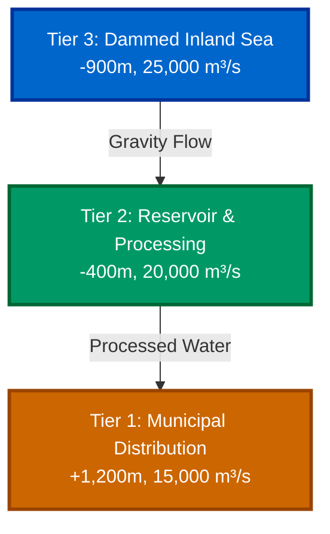

*This would render as a vertical flowchart showing water flowing from Tier 3 to Tier 2 to Tier 1.*

---

## 📊 EXAMPLE 2: GRAND RIVER WATER FLOW DIAGRAM

```mermaid
flowchart TB
    subgraph Tier_3["Tier 3: Deep Core (-600m to -900m)"]
        DIS[Dammed Inland Sea\nNode: 0178-0181]
        DWI[Deep Water Intake\nNode: 0250]
        UEC[Underwater Energy Capture]
    end
    
    subgraph Tier_2["Tier 2: Reservoir (-200m to -400m)"]
        GRD[Grand River Turbines\nNode: 0091]
        DES[Desalination Plant\nNode: 0156]
        SMR[SMR Array\nNode: 0248]
        CRF[Current Redirection\nNode: 0249]
        FWB[Freshwater Basin\nNode: 0175]
        CSR[Canyon de Chelly\nSaltwater Reserve\nNode: 0176]
    end
    
    subgraph Tier_1["Tier 1: Capitol (+0m to +1,200m)"]
        MDP[Municipal Distribution\nNode: 0155]
        BRF[Bottling Refineries\nNode: 0195-0199]
        OWH[On-Water Hospitality\nNode: 0189, 0193]
    end
    
    DIS -->|25,000 m³/s| DWI
    DWI -->|Raw Water| GRD
    DWI -->|Raw Water| DES
    GRD -->|Power Generation| SMR
    GRD -->|Flow Control| CRF
    DES -->|Freshwater| FWB
    FWB -->|Processed| MDP
    CSR -->|Saltwater| DES
    MDP -->|Distribution| BRF
    MDP -->|Distribution| OWH
    
    style Tier_3 fill:#111122,stroke:#333366,stroke-width:2px
    style Tier_2 fill:#112211,stroke:#336633,stroke-width:2px
    style Tier_1 fill:#221111,stroke:#663333,stroke-width:2px
```

*This shows the complete water flow with specific node references.*

---

## 📊 EXAMPLE 3: STAKEHOLDER ACCESS FLOW

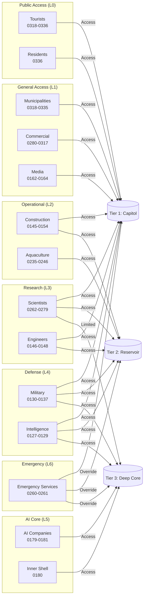

*This shows how different access levels map to tier access.*

---

## 📊 EXAMPLE 4: MOBILITY SYSTEM DIAGRAM

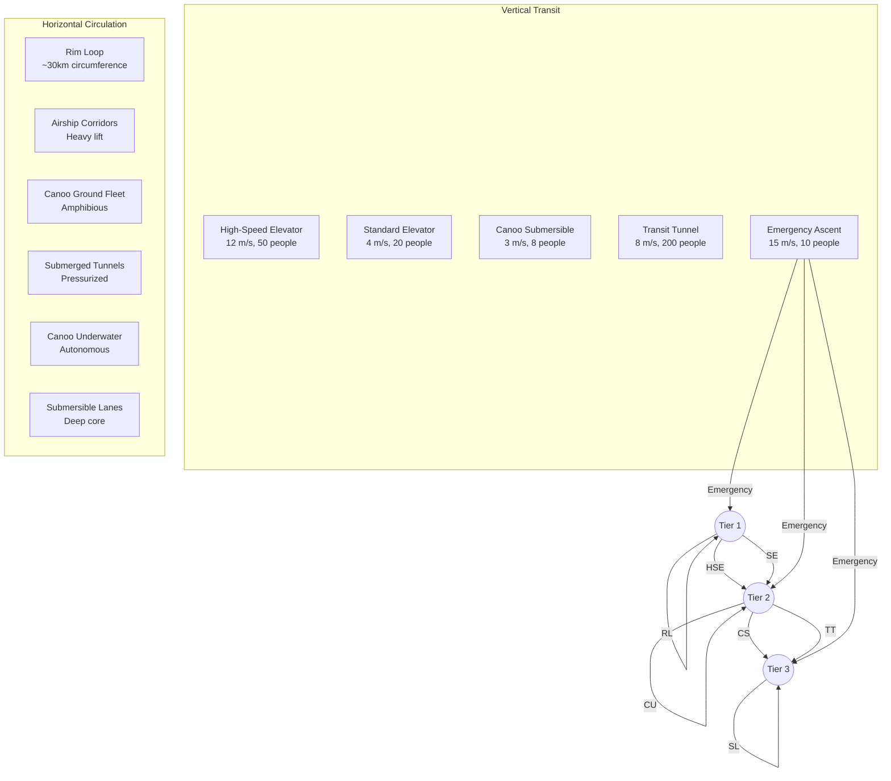

*This shows the complete mobility infrastructure.*

---

## 📊 EXAMPLE 5: GANTT CHART (Implementation Timeline)

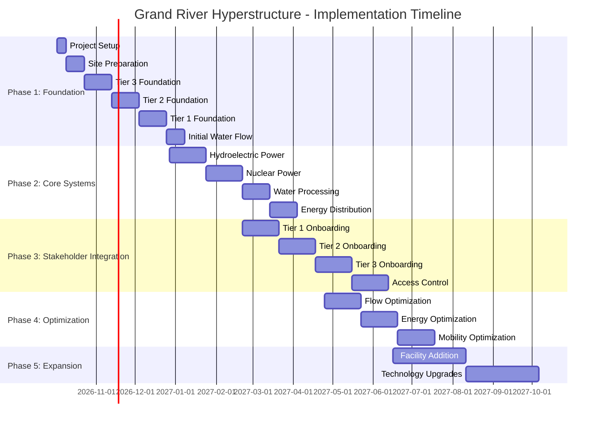

*This shows the 5-phase implementation timeline.*

---

## 📊 EXAMPLE 6: CLASS DIAGRAM (System Components)

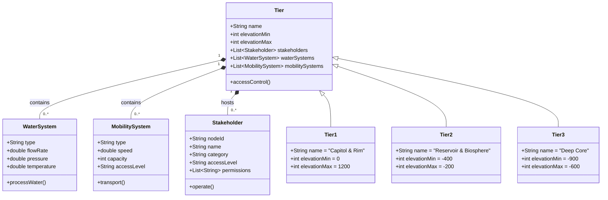

*This shows the object-oriented structure of the hyperstructure.*

---

## 📊 EXAMPLE 7: STATE DIAGRAM (Water Flow States)

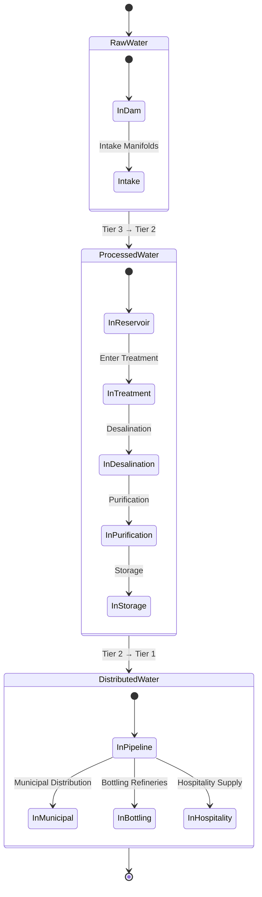

*This shows the state transitions of water as it flows through the system.*

---

## 📊 EXAMPLE 8: PIE CHART (Stakeholder Distribution)

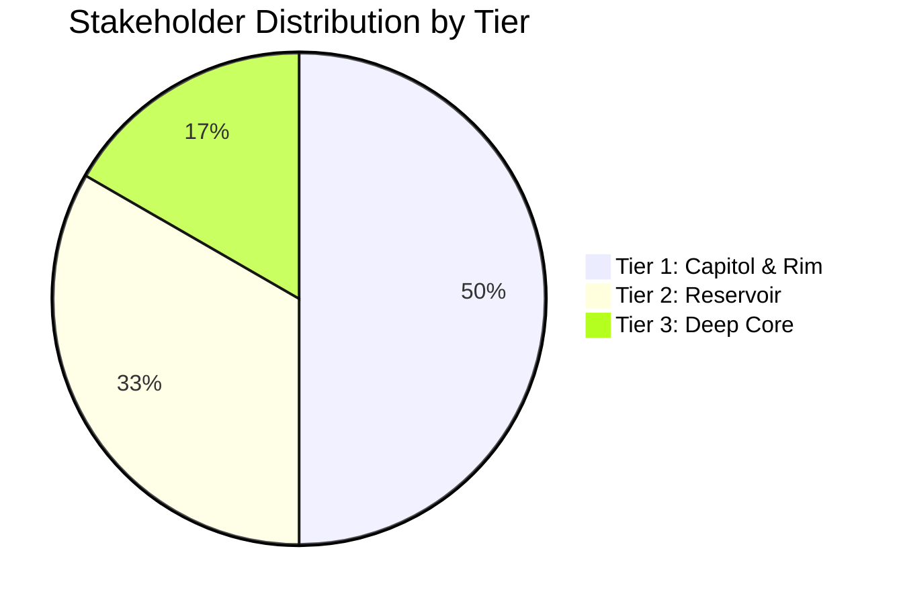

*This shows the distribution of stakeholders across tiers.*

---

## 📊 EXAMPLE 9: COMPLEX FLOWCHART (Complete System)

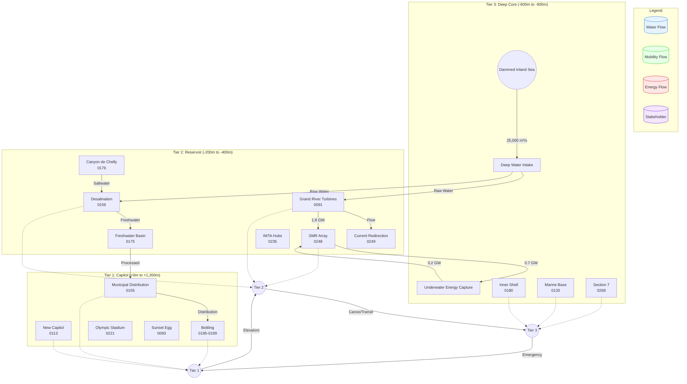

*This is a comprehensive diagram showing water flow, energy flow, mobility flow, and stakeholder placement.*

---

## 💡 HOW TO USE MERMAID

### In GitHub/GitLab:
Simply include Mermaid syntax in your Markdown files. The platform will automatically render the diagrams.

### In VS Code:
1. Install the **Mermaid extension** (by bierner)
2. Create a `.mmd` file or use Markdown with Mermaid code blocks
3. The extension will render the diagrams in a preview pane

### In Other Platforms:
Many documentation tools support Mermaid natively, including:
- Notion (with Mermaid plugin)
- Obsidian (with Mermaid plugin)
- Typora
- Docusaurus
- MkDocs with Mermaid plugin

### Online Editors:
- [Mermaid Live Editor](https://mermaid.live/) - Test and visualize your diagrams
- [Mermaid Chart](https://www.mermaidchart.com/) - Create and share diagrams

---

## 📚 MERMAID SYNTAX REFERENCE

### Basic Structure
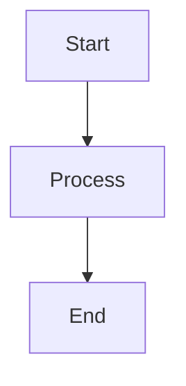

### Node Types
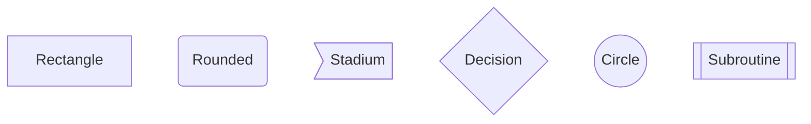

### Connections
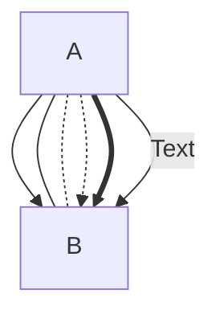

### Styling
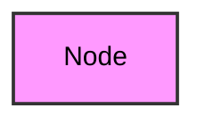

### Themes
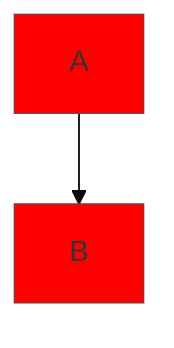

---

## 🎯 WHY MERMAID IS USEFUL

1. **Text-Based:** Easy to version control and collaborate on
2. **Platform-Agnostic:** Works across many documentation platforms
3. **Quick to Learn:** Simple syntax that's easy to understand
4. **Maintainable:** Easier to update than binary diagram files
5. **Consistent:** Always renders the same way given the same code
6. **Accessible:** Can be read as text if diagrams don't render

---

## 📁 SAVING MERMAID DIAGRAMS

To save Mermaid diagrams as images:
1. Use the [Mermaid Live Editor](https://mermaid.live/)
2. Paste your Mermaid code
3. Click "Download" to save as SVG or PNG
4. Or use command-line tools like `mermaid-cli`

---

**Would you like me to create a specific Mermaid diagram for the Grand River Hyperstructure, or would you like to see more examples of different diagram types?**
