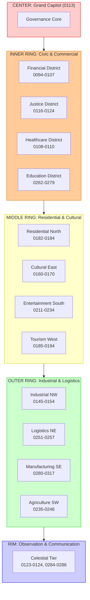
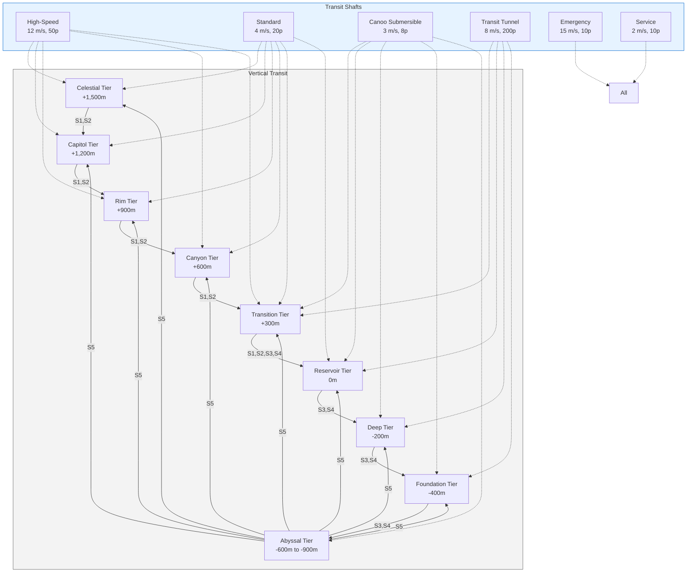
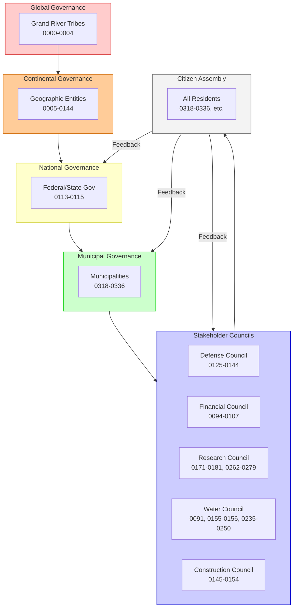

# 🏗️ MISTVEIL CITY: TECHNICAL INTEGRATION WITH GRAND RIVER HYPERSTRUCTURE

**Document Version:** 1.0.0  
**Date:** 2026-10-02  
**Classification:** HarshalOS Gem - Technical Specification  
**Parent Document:** MISTVEIL-CITY-VISION.md  
**Status:** Integration-Ready Framework

---

## 📋 EXECUTIVE SUMMARY

This document provides the **technical integration framework** for **Mistveil City**—the **80-million-person Capitol** of the Grand River Foundation Hyperstructure. It details how the **visionary Human-Reactor** concept translates into **physical infrastructure**, **system architecture**, and **operational integration** with the existing three-tiered hyperstructure.

**Key Integration Points:**
- **Geographic:** Sprawling across 277 miles of Arizona Grand Canyon rim
- **Vertical:** Multi-leveled from +1,500m (Celestial Tier) to -900m (Abyssal Tier)
- **Population:** 80 million by 2100, representing 8 billion surface worlders
- **Stakeholder:** Full representation of all 360+ Grand River nodes
- **Infrastructure:** Seamless integration with water, energy, mobility systems

---

# 🗺️ PHYSICAL INTEGRATION

---

## 📐 1.1 GEOGRAPHIC SCOPE & TOPOGRAPHY

### 1.1.1 Canyon Geometry

**Grand Canyon (Arizona Side):**
- **Length:** 277 miles (446 km) - **Mistveil City spans the entire length**
- **Width:** 4-18 miles (6-29 km) - **City width varies by canyon topology**
- **Depth:** Up to 1 mile (1,600 m) - **City extends below rim to -900m**
- **Rim Elevation:** 6,000-7,000 ft (+1,800-2,100 m) - **City extends above rim**

**Mistveil City Footprint:**
- **Total Area:** ~5,000 km² (1.93 million acres)
- **Built-Up Area:** ~3,500 km² (initial phase)
- **Green/Blue Space:** ~1,500 km² (30% of total)
- **Vertical Footprint:** 2,400 m elevation range (+1,500m to -900m)

### 1.1.2 Canyon Cross-Section with City Levels

```
┌─────────────────────────────────────────────────────────────────────────────┐
│                    MISTVEIL CITY - CANYON CROSS-SECTION                            │
│                            (Looking North)                                         │
├─────────────────────────────────────────────────────────────────────────────┤
│                                                                                 │
│  ELEVATION: +1,500m ─────────────────────────────────────────────────────┤
│  ┌─────────────────────────────────────────────────────────────────────┐    │
│  │  CELESTIAL TIER (2M population)                                        │    │
│  │  ┌─────────────┐  ┌─────────────┐  ┌─────────────┐                  │    │
│  │  │ Observation  │  │ Communication│  │ Atmospheric │                  │    │
│  │  │ Decks        │  │ Hubs         │  │ Interface    │                  │    │
│  │  └─────────────┘  └─────────────┘  └─────────────┘                  │    │
│  └─────────────────────────────────────────────────────────────────────┘    │
│                                                                                 │
│  ELEVATION: +1,200m ─────────────────────────────────────────────────────┤
│  ┌─────────────────────────────────────────────────────────────────────┐    │
│  │  CAPITOL TIER (20M population) - TIER 1 INTEGRATION                    │    │
│  │  ┌─────────────────────────────────────────────────────────────┐    │    │
│  │  │  New Capitol (0113) | Municipal Distribution (0155)             │    │    │
│  │  │  Olympic Stadium (0221) | Bottling Refineries (0195-0199)        │    │    │
│  │  │  Sunset Egg (0093) | Autonomous Airborne Corridors (0210)     │    │    │
│  │  │  All Municipalities (0318-0336) | Financial Infrastructure (0094-0107)│    │    │
│  │  └─────────────────────────────────────────────────────────────┘    │    │
│  └─────────────────────────────────────────────────────────────────────┘    │
│                              │                                           │
│  ELEVATION: +900m ──────────────────────────────────────────────────────┤
│  ┌─────────────────────────────────────────────────────────────────────┐    │
│  │  RIM TIER (15M population)                                             │    │
│  │  ┌─────────────────────────────────────────────────────────────┐    │    │
│  │  │  Residential Districts | Cultural Centers | Educational Hubs     │    │    │
│  │  │  Justice & Surveillance (0116-0124) | Advocacy (0157-0170)            │    │    │
│  │  │  Entertainment (0211-0234) | Tourism (0185-0194)                  │    │    │
│  │  └─────────────────────────────────────────────────────────────┘    │    │
│  └─────────────────────────────────────────────────────────────────────┘    │
│                              │                                           │
│  ELEVATION: +600m ──────────────────────────────────────────────────────┤
│  ┌─────────────────────────────────────────────────────────────────────┐    │
│  │  CANYON TIER (18M population)                                         │    │
│  │  ┌─────────────────────────────────────────────────────────────┐    │    │
│  │  │  Industrial Zones | Manufacturing | Logistics Hubs                │    │    │
│  │  │  Construction & Engineering (0145-0154) | Global Bodies (0280-0317)│    │    │
│  │  │  Transportation Networks | Energy Distribution                         │    │    │
│  │  └─────────────────────────────────────────────────────────────┘    │    │
│  └─────────────────────────────────────────────────────────────────────┘    │
│                              │                                           │
│  ELEVATION: +300m ──────────────────────────────────────────────────────┤
│  ┌─────────────────────────────────────────────────────────────────────┐    │
│  │  TRANSITION TIER (10M population) - TIER 2 INTEGRATION                │    │
│  │  ┌─────────────────────────────────────────────────────────────┐    │    │
│  │  │  Water Processing (0155-0156) | Desalination Mid-Pipeline (0156)     │    │    │
│  │  │  Circulation Management (0247) | Current Redirection (0249)          │    │    │
│  │  │  Transit Hubs | Vertical Shafts | Emergency Access                 │    │    │
│  │  └─────────────────────────────────────────────────────────────┘    │    │
│  └─────────────────────────────────────────────────────────────────────┘    │
│                              │                                           │
│  ELEVATION: 0m ───────────────────────────────────────────────────────────┤
│  ┌─────────────────────────────────────────────────────────────────────┐    │
│  │  RESERVOIR TIER (8M population) - TIER 2 INTEGRATION                   │    │
│  │  ┌─────────────────────────────────────────────────────────────┐    │    │
│  │  │  Main Freshwater Basin (0175) | Canyon de Chelly (0176)             │    │    │
│  │  │  Grand River Turbines (0091) | SMR Array (0248)                    │    │    │
│  │  │  IMTA Aquaculture (0235) | Research Facilities (0272-0273)      │    │    │
│  │  │  Aquatic Resources (0171-0178) | Submerged Transit Tunnels           │    │    │
│  │  └─────────────────────────────────────────────────────────────┘    │    │
│  └─────────────────────────────────────────────────────────────────────┘    │
│                              │                                           │
│  ELEVATION: -200m ─────────────────────────────────────────────────────┤
│  ┌─────────────────────────────────────────────────────────────────────┐    │
│  │  DEEP TIER (5M population) - TIER 3 INTEGRATION                       │    │
│  │  ┌─────────────────────────────────────────────────────────────┐    │    │
│  │  │  Secure Operations | Defense Mid-Level (0134)                     │    │    │
│  │  │  Underwater Energy Capture (0250) | Carbon Mineralization (0178)     │    │    │
│  │  │  Canoo Underwater Fleet (0204) | Maintenance Drones                   │    │    │
│  │  └─────────────────────────────────────────────────────────────┘    │    │
│  └─────────────────────────────────────────────────────────────────────┘    │
│                              │                                           │
│  ELEVATION: -400m ─────────────────────────────────────────────────────┤
│  ┌─────────────────────────────────────────────────────────────────────┐    │
│  │  FOUNDATION TIER (2M population) - TIER 3 INTEGRATION                 │    │
│  │  ┌─────────────────────────────────────────────────────────────┐    │    │
│  │  │  Core Infrastructure | Energy Storage | Deep Research                 │    │    │
│  │  │  Naval Base (0133) | Marines Base (0132)                           │    │    │
│  │  │  Transit Tunnels | Emergency Ascent Shafts                        │    │    │
│  │  └─────────────────────────────────────────────────────────────┘    │    │
│  └─────────────────────────────────────────────────────────────────────┘    │
│                              │                                           │
│  ELEVATION: -600m to -900m ─────────────────────────────────────────────┤
│  ┌─────────────────────────────────────────────────────────────────────┐    │
│  │  ABYSSAL TIER (100K population) - TIER 3 CORE                          │    │
│  │  ┌─────────────────────────────────────────────────────────────┐    │    │
│  │  │  Inner Shell (0180) | AI Companies (0179, 0181)                     │    │    │
│  │  │  Section 7 (0268) | Section 4 (0269) | Section 0 (0270)             │    │    │
│  │  │  Deep Core Systems | Ultimate Security                             │    │    │
│  │  └─────────────────────────────────────────────────────────────┘    │    │
│  └─────────────────────────────────────────────────────────────────────┘    │
│                                                                                 │
│  HORIZONTAL EXTENT: 277 miles (446 km) along Arizona Grand Canyon rim           │
│  VERTICAL EXTENT: 2,400 m (+1,500m to -900m)                                    │
│  TOTAL POPULATION: 80,000,100                                                   │
│                                                                                 │
└─────────────────────────────────────────────────────────────────────────────┘
```

---

## 📊 1.2 LEVEL SPECIFICATIONS

### 1.2.1 Celestial Tier (+1,200m to +1,500m)

| **Parameter** | **Value** | **Notes** |
|--------------|-----------|-----------|
| **Elevation** | +1,200m to +1,500m | Above rim level |
| **Population** | 2,000,000 | Low density, specialized |
| **Area** | 500 km² | Distributed along rim |
| **Primary Function** | Observation, communication, atmospheric interface | - |
| **Stakeholders** | Panoptes (0124), Drone Ops (0123), Global Bodies (0284-0286) | - |
| **Infrastructure** | Observation decks, communication towers, atmospheric domes | - |
| **Transit** | High-speed elevators to Capitol Tier, airborne corridors | - |
| **Water** | Minimal - atmospheric collection | - |
| **Energy** | Solar arrays, wind turbines | - |
| **Atmosphere** | Open sky | - |

### 1.2.2 Capitol Tier (+900m to +1,200m) - **Tier 1 Integration**

| **Parameter** | **Value** | **Notes** |
|--------------|-----------|-----------|
| **Elevation** | +900m to +1,200m | Rim level |
| **Population** | 20,000,000 | High density, civic core |
| **Area** | 1,200 km² | Central district |
| **Primary Function** | Governance, commerce, public life | **Tier 1 Primary** |
| **Stakeholders** | Tribal Gov (0000-0004), Federal Gov (0113-0115), Financial (0094-0107), Municipalities (0318-0336) | - |
| **Infrastructure** | New Capitol (0113), Olympic Stadium (0221), Sunset Egg (0093), Municipal Distribution (0155) | - |
| **Transit** | All elevator types, Canoo ground fleet, airborne corridors | - |
| **Water** | Full municipal supply | From T2 processing |
| **Energy** | Primary grid distribution | From T2 generation |
| **Atmosphere** | Open sky | - |

### 1.2.3 Rim Tier (+600m to +900m)

| **Parameter** | **Value** | **Notes** |
|--------------|-----------|-----------|
| **Elevation** | +600m to +900m | Upper canyon |
| **Population** | 15,000,000 | Residential focus |
| **Area** | 1,000 km² | Residential districts |
| **Primary Function** | Residential, cultural, educational | - |
| **Stakeholders** | Justice (0116-0124), Advocacy (0157-0170), Entertainment (0211-0234), Tourism (0185-0194) | - |
| **Infrastructure** | Residential towers, cultural centers, educational hubs, rim loop monorail | - |
| **Transit** | All transit modes | Hub for horizontal movement |
| **Water** | Full municipal supply | - |
| **Energy** | Full grid access | - |
| **Atmosphere** | Open sky | - |

### 1.2.4 Canyon Tier (+300m to +600m)

| **Parameter** | **Value** | **Notes** |
|--------------|-----------|-----------|
| **Elevation** | +300m to +600m | Mid-canyon |
| **Population** | 18,000,000 | Industrial focus |
| **Area** | 800 km² | Industrial zones |
| **Primary Function** | Industrial, manufacturing, logistics | - |
| **Stakeholders** | Construction (0145-0154), Global Bodies (0280-0317), Transportation (0251-0257) | - |
| **Infrastructure** | Manufacturing plants, logistics hubs, transportation networks | - |
| **Transit** | All transit modes, cargo elevators | - |
| **Water** | Industrial supply | From T2 processing |
| **Energy** | High-demand grid | Industrial load |
| **Atmosphere** | Partial canyon | Some open sky |

### 1.2.5 Transition Tier (0m to +300m) - **Tier 2 Integration**

| **Parameter** | **Value** | **Notes** |
|--------------|-----------|-----------|
| **Elevation** | 0m to +300m | Lower canyon |
| **Population** | 10,000,000 | Transportation focus |
| **Area** | 500 km² | Transition zone |
| **Primary Function** | Transportation, energy, water management | **Tier 2 Primary** |
| **Stakeholders** | Water Processing (0155-0156), Circulation (0247-0249), Mobility (0202-0210) | - |
| **Infrastructure** | Vertical transit shafts, water conveyance, energy distribution | - |
| **Transit** | Primary vertical transit hub | Connection to T2 |
| **Water** | Processing and distribution | Major water systems |
| **Energy** | Generation and distribution | Hydroelectric and SMR |
| **Atmosphere** | Canyon walls | Limited open sky |

### 1.2.6 Reservoir Tier (-200m to 0m) - **Tier 2 Integration**

| **Parameter** | **Value** | **Notes** |
|--------------|-----------|-----------|
| **Elevation** | -200m to 0m | Sub-rim |
| **Population** | 8,000,000 | Water focus |
| **Area** | 400 km² | Reservoir zone |
| **Primary Function** | Water processing, aquaculture, research | **Tier 2 Primary** |
| **Stakeholders** | Aquatic Resources (0171-0178), Aquaculture (0235-0246), Research (0262-0279) | - |
| **Infrastructure** | Main Freshwater Basin (0175), Canyon de Chelly (0176), Desalination (0156), IMTA Hubs (0235) | - |
| **Transit** | Submerged tunnels, Canoo underwater | - |
| **Water** | Primary processing | Desalination, purification |
| **Energy** | SMR Array (0248), Hydroelectric (0091) | - |
| **Atmosphere** | Submerged light | Artificial + natural |

### 1.2.7 Deep Tier (-400m to -200m) - **Tier 3 Integration**

| **Parameter** | **Value** | **Notes** |
|--------------|-----------|-----------|
| **Elevation** | -400m to -200m | Deep canyon |
| **Population** | 5,000,000 | Secure operations |
| **Area** | 300 km² | Deep zone |
| **Primary Function** | Secure operations, defense, advanced research | **Tier 3 Integration** |
| **Stakeholders** | Defense Mid-Level (0134), AI Core (0179-0181), Deep Research (0262-0274) | - |
| **Infrastructure** | Secure facilities, underwater energy capture (0250), carbon mineralization (0178) | - |
| **Transit** | Canoo submersible, transit tunnels | - |
| **Water** | Limited supply | Deep intake |
| **Energy** | Underwater capture, backup SMR | - |
| **Atmosphere** | Artificial light | Fully enclosed |

### 1.2.8 Foundation Tier (-600m to -400m) - **Tier 3 Integration**

| **Parameter** | **Value** | **Notes** |
|--------------|-----------|-----------|
| **Elevation** | -600m to -400m | Deep core |
| **Population** | 2,000,000 | Core infrastructure |
| **Area** | 200 km² | Foundation zone |
| **Primary Function** | Core infrastructure, energy storage, deep research | **Tier 3 Primary** |
| **Stakeholders** | Naval Base (0133), Marines Base (0132), Research (0272-0274) | - |
| **Infrastructure** | Core systems, energy storage, deep research facilities | - |
| **Transit** | Transit tunnels, service drones | - |
| **Water** | Minimal | Core systems only |
| **Energy** | Storage and distribution | - |
| **Atmosphere** | Artificial light | Hermetic |

### 1.2.9 Abyssal Tier (-900m to -600m) - **Tier 3 Core**

| **Parameter** | **Value** | **Notes** |
|--------------|-----------|-----------|
| **Elevation** | -900m to -600m | Maximum depth |
| **Population** | 100,000 | AI and ultimate security |
| **Area** | 100 km² | Abyssal zone |
| **Primary Function** | AI core, ultimate security, deep systems | **Tier 3 Core** |
| **Stakeholders** | Inner Shell (0180), AI Companies (0179, 0181), Section 7 (0268), Section 4 (0269), Section 0 (0270) | - |
| **Infrastructure** | Inner Shell, AI hardware, ultimate security systems | - |
| **Transit** | Emergency ascent only | - |
| **Water** | Dammed inland sea | Primary source |
| **Energy** | Underwater capture | - |
| **Atmosphere** | Hermetic | Maximum security |

---

## 🌆 1.3 CITY LAYOUT & DISTRICTS

### 1.3.1 Longitudinal Organization (Along Canyon)

The city is organized **longitudinally** along the 277-mile canyon, with **districts** assigned based on **function and stakeholder representation**:

```
WEST END (Mile 0) ───────────────────────────────────────────────────── EAST END (Mile 277)

┌─────────────┬─────────────┬─────────────┬─────────────┬─────────────┐
│  Defense     │  Governance  │  Financial    │  Research    │  Global      │
│  District    │  District    │  District     │  District    │  District    │
│  (Miles 0-50)│  (Miles 50- │  (Miles 100-  │  (Miles 150- │  (Miles 200-│
│              │  100)       │  150)        │  200)       │  277)       │
├─────────────┼─────────────┼─────────────┼─────────────┼─────────────┤
│  Naval Base  │  New Capitol │  US Mint     │  Colorado    │  UN Agencies │
│  (0133)      │  (0113)     │  (0094)      │  River Inst  │  (0285)     │
│  Marines     │  Tribal Gov │  Financiers  │  (0264)      │  Int'l Bodies│
│  (0132)      │  (0000-0004)│  (0095-0107) │  NAU         │  (0284)     │
│  Air Force   │  Justice    │              │  Underwater  │              │
│  (0135)      │  (0116-0124)│              │  (0274)      │              │
└─────────────┴─────────────┴─────────────┴─────────────┴─────────────┘

CENTRAL DISTRICT (Miles 100-177) - Main Civic & Commercial Core
```

### 1.3.2 Radial Organization (From Center)

Each **50-mile segment** has a **radial organization** with the **Grand Capitol** at the center:



### 1.3.3 Vertical Organization (All Levels)

Every **point** in Mistveil City has **vertical connectivity** to all other levels:

```
┌─────────────────────┐
│  CELESTIAL TIER      │  +1,500m
├──────────┬──────────┤
│  CAPITOL  │  RIM     │  +1,200m
├──────────┼──────────┤
│  TIER     │  TIER   │  +900m
├──────────┼──────────┤
│  CANYON   │  CANYON │  +600m
├──────────┼──────────┤
│  TRANSITION│ TRANSITION│  +300m
├──────────┼──────────┤
│  RESERVOIR│ RESERVOIR│    0m
├──────────┼──────────┤
│  DEEP     │  DEEP   │  -200m
├──────────┼──────────┤
│  FOUNDATION│FOUNDATION│  -400m
├──────────┼──────────┤
│  ABYSSAL  │  ABYSSAL│  -600m
└──────────┴──────────┘
     │
     ▼ (Vertical Transit Shafts at every 1km interval)
     ▼
┌─────────────────────┐
│  ABYSSAL TIER        │  -900m
└─────────────────────┘
```

**Vertical Transit Density:**
- **1 vertical shaft per square kilometer** in urban areas
- **High-speed elevators** connecting all major levels
- **Standard elevators** for local vertical movement
- **Emergency ascent shafts** at 5km intervals
- **Service ducts** for maintenance and utilities

---

# 👥 2. STAKEHOLDER INTEGRATION

---

## 📊 2.1 POPULATION DISTRIBUTION

### 2.1.1 By Level

| **Level** | **Population** | **Percentage** | **Density** | **Primary Function** |
|-----------|---------------|---------------|-------------|---------------------|
| Celestial Tier | 2,000,000 | 2.5% | 4,000/km² | Observation, communication |
| Capitol Tier | 20,000,000 | 25% | 16,667/km² | Governance, commerce |
| Rim Tier | 15,000,000 | 18.75% | 15,000/km² | Residential, cultural |
| Canyon Tier | 18,000,000 | 22.5% | 22,500/km² | Industrial, manufacturing |
| Transition Tier | 10,000,000 | 12.5% | 20,000/km² | Transportation, energy |
| Reservoir Tier | 8,000,000 | 10% | 20,000/km² | Water, aquaculture |
| Deep Tier | 5,000,000 | 6.25% | 16,667/km² | Secure operations |
| Foundation Tier | 2,000,000 | 2.5% | 10,000/km² | Core infrastructure |
| Abyssal Tier | 100,000 | 0.125% | 1,000/km² | AI, ultimate security |
| **Total** | **80,000,100** | **100%** | **16,000/km²** | **Human-Reactor** |

### 2.1.2 By Stakeholder Category

| **Category** | **Population** | **Percentage** | **Primary Levels** | **Nodes** |
|--------------|---------------|---------------|-------------------|----------|
| Governance & Regulation | 7,000,000 | 8.75% | Capitol, Rim | 0000-0004, 0113-0115 |
| Financial & Commercial | 15,000,000 | 18.75% | Capitol, Canyon | 0094-0107, 0280-0317 |
| Defense & Security | 10,000,000 | 12.5% | Transition, Deep | 0116-0144, 0130-0139 |
| Research & Education | 10,000,000 | 12.5% | Rim, Reservoir, Deep | 0171-0181, 0262-0279 |
| Water & Energy | 5,000,000 | 6.25% | Transition, Reservoir | 0091, 0155-0156, 0235-0250 |
| Construction & Engineering | 8,000,000 | 10% | Canyon, Transition | 0145-0154 |
| Residential & Hospitality | 12,000,000 | 15% | Rim, Capitol | 0182-0194, 0318-0336 |
| Entertainment & Recreation | 8,000,000 | 10% | Rim, Capitol | 0211-0234 |
| Advocacy & Culture | 3,000,000 | 3.75% | Rim, Capitol | 0157-0170 |
| Transportation & Mobility | 2,000,000 | 2.5% | All Levels | 0202-0210, 0251-0257 |
| **Total** | **80,000,000** | **100%** | **All Levels** | **0000-0359** |

---

## 🔗 2.2 STAKEHOLDER TO LEVEL MAPPING

### 2.2.1 Celestial Tier Stakeholders

| **Node** | **Name** | **Population** | **Function** | **Access** |
|----------|----------|---------------|-------------|------------|
| 0123 | Drone Operations | 500,000 | Aerial surveillance | L3 |
| 0124 | Panoptes Hotline | 300,000 | System monitoring | L3 |
| 0284-0286 | International Bodies | 1,200,000 | Global coordination | L3 |

### 2.2.2 Capitol Tier Stakeholders

| **Node** | **Name** | **Population** | **Function** | **Access** |
|----------|----------|---------------|-------------|------------|
| 0000-0004 | Tribal Governance | 2,000,000 | Tribal representation | L2 |
| 0094-0107 | Financial Infrastructure | 5,000,000 | Financial operations | L1 |
| 0113-0115 | Government | 3,000,000 | Governance | L2 |
| 0116-0124 | Justice & Surveillance | 2,000,000 | Law enforcement | L2-L3 |
| 0211-0234 | Entertainment | 5,000,000 | Cultural expression | L1 |
| 0280-0317 | Global Bodies | 3,000,000 | International relations | L1-L3 |
| 0318-0336 | Municipalities | 5,000,000 | Local governance | L0-L1 |

### 2.2.3 Rim Tier Stakeholders

| **Node** | **Name** | **Population** | **Function** | **Access** |
|----------|----------|---------------|-------------|------------|
| 0145-0154 | Construction & Engineering | 4,000,000 | Building and maintenance | L2 |
| 0157-0170 | Advocacy & Culture | 3,000,000 | Social and cultural | L1-L2 |
| 0171-0181 | Aquatic Resources & AI | 2,000,000 | Water and AI | L2-L5 |
| 0182-0194 | Housing & Hospitality | 6,000,000 | Residential and tourism | L1-L2 |

### 2.2.4 Canyon Tier Stakeholders

| **Node** | **Name** | **Population** | **Function** | **Access** |
|----------|----------|---------------|-------------|------------|
| 0145-0154 | Construction & Engineering | 4,000,000 | Industrial construction | L2 |
| 0251-0257 | Transportation | 2,000,000 | Cargo and logistics | L1 |
| 0280-0317 | Global Bodies | 3,000,000 | International enterprise | L1-L3 |
| 0287-0298 | Telecommunications | 5,000,000 | Connectivity | L1 |
| Various | Manufacturing | 4,000,000 | Production | L1-L2 |

### 2.2.5 Transition Tier Stakeholders

| **Node** | **Name** | **Population** | **Function** | **Access** |
|----------|----------|---------------|-------------|------------|
| 0091 | Grand River Turbines | 500,000 | Hydroelectric power | L3 |
| 0155-0156 | Pipeline & Desalination | 1,000,000 | Water conveyance | L2-L3 |
| 0202-0210 | Canoo Fleet | 500,000 | Autonomous transport | L2 |
| 0247-0249 | Circulation & Redirection | 1,000,000 | Water flow control | L3 |
| 0251-0257 | Transportation | 2,000,000 | Mass transit | L1 |
| Various | Energy Distribution | 5,500,000 | Power grid | L2 |

### 2.2.6 Reservoir Tier Stakeholders

| **Node** | **Name** | **Population** | **Function** | **Access** |
|----------|----------|---------------|-------------|------------|
| 0171-0178 | Aquatic Resources | 1,500,000 | Water management | L2 |
| 0175 | Freshwater Basin | 500,000 | Main reservoir | L2 |
| 0176 | Canyon de Chelly | 500,000 | Saltwater reserve | L3 |
| 0235-0246 | Aquaculture | 2,000,000 | Food production | L2 |
| 0262-0279 | Research & Education | 3,000,000 | Knowledge creation | L3 |
| 0248 | SMR Array | 500,000 | Nuclear power | L3 |

### 2.2.7 Deep Tier Stakeholders

| **Node** | **Name** | **Population** | **Function** | **Access** |
|----------|----------|---------------|-------------|------------|
| 0132-0134 | Defense Mid-Level | 2,000,000 | Maritime security | L3-L4 |
| 0179-0181 | AI Companies | 500,000 | AI operations | L5 |
| 0250 | Underwater Energy | 500,000 | Energy capture | L3 |
| 0262-0274 | Deep Research | 1,500,000 | Advanced research | L3 |
| 0178 | Carbon Mineralization | 500,000 | CO2 capture | L2 |

### 2.2.8 Foundation Tier Stakeholders

| **Node** | **Name** | **Population** | **Function** | **Access** |
|----------|----------|---------------|-------------|------------|
| 0132-0133 | Naval & Marine Bases | 1,000,000 | Deep defense | L4 |
| 0268-0270 | Section 7/4/0 | 500,000 | Secure command | L4 |
| Various | Core Infrastructure | 500,000 | System maintenance | L3 |

### 2.2.9 Abyssal Tier Stakeholders

| **Node** | **Name** | **Population** | **Function** | **Access** |
|----------|----------|---------------|-------------|------------|
| 0179-0181 | AI Companies & Inner Shell | 50,000 | AI core | L5 |
| 0267 | AI Evolution Research | 30,000 | AI advancement | L5 |
| 0268-0270 | Section 7/4/0 | 20,000 | Ultimate security | L4 |

---

# 🏗️ 3. INFRASTRUCTURE INTEGRATION

---

## 💧 3.1 WATER SYSTEM INTEGRATION

### 3.1.1 Water Flow Path Through Mistveil City

```
┌─────────────────────────────────────────────────────────────────────────────┐
│  WATER FLOW: MISTVEIL CITY INTEGRATION                                        │
├─────────────────────────────────────────────────────────────────────────────┤
│                                                                                 │
│  SOURCE: Dammed Inland Sea (T3, -900m)                                        │
│  ┌─────────────────────────────────────────────────────────────────────┐    │
│  │  Volume: 60 billion m³ | Node: 0178, 0250                               │    │
│  │  Intake: Deep water manifolds | Flow: 25,000 m³/s                       │    │
│  └─────────────────────────────────────────────────────────────────────┘    │
│                              │                                           │
│                              ▼ 5×36m pipes, 4.91 m/s                      │
│                              │                                           │
│  FOUNDATION TIER (-600m to -400m)                                             │
│  ┌─────────────────────────────────────────────────────────────────────┐    │
│  │  Underwater Energy Capture (0250)                                        │    │
│  │  Carbon Mineralization Grid (0178)                                       │    │
│  │  Flow: 25,000 m³/s | Pressure: 7.46 MPa                              │    │
│  └─────────────────────────────────────────────────────────────────────┘    │
│                              │                                           │
│                              ▼ 4×36m pipes, 4.91 m/s                      │
│                              │                                           │
│  DEEP & RESERVOIR TIERS (-400m to 0m)                                         │
│  ┌─────────────────────────────────────────────────────────────────────┐    │
│  │  Grand River Turbines (0091): 1.8 GW generation                         │    │
│  │  SMR Array (0248): 0.6 GW generation                                       │    │
│  │  Desalination Plant (0156): 0.87 GW energy, 500 m³/s freshwater         │    │
│  │  Main Freshwater Basin (0175): 10 billion m³ storage                     │    │
│  │  Canyon de Chelly (0176): 3 billion m³ saltwater reserve                   │    │
│  │  IMTA Aquaculture (0235): Aquatic food production                         │    │
│  │  Flow: 20,000 m³/s | Pressure: 3.04 MPa                              │    │
│  └─────────────────────────────────────────────────────────────────────┘    │
│                              │                                           │
│                              ▼ 4×36m pipes, 4.91 m/s                      │
│                              │                                           │
│  TRANSITION TIER (0m to +300m)                                                │
│  ┌─────────────────────────────────────────────────────────────────────┐    │
│  │  Current Redirection (0249): Flow control                                 │    │
│  │  Pipeline People (0155): Distribution network                               │    │
│  │  Circulation Management (0247): System monitoring                         │    │
│  │  Flow: 20,000 m³/s | Pressure: 2.06 MPa                              │    │
│  └─────────────────────────────────────────────────────────────────────┘    │
│                              │                                           │
│                              ▼ 10×25m pipes, 3.05 m/s                     │
│                              │                                           │
│  CAPITOL & RIM TIERS (+300m to +1,200m)                                      │
│  ┌─────────────────────────────────────────────────────────────────────┐    │
│  │  Municipal Distribution (0155): Full city supply                         │    │
│  │  Bottling Refineries (0195-0199): Commercial water products               │    │
│  │  On-Water Hospitality (0189, 0193): Tourism and accommodation             │    │
│  │  Flow: 15,000 m³/s | Pressure: 0.30 MPa                              │    │
│  └─────────────────────────────────────────────────────────────────────┘    │
│                              │                                           │
│                              ▼                                           │
│  CELESTIAL TIER (+1,200m to +1,500m)                                          │
│  ┌─────────────────────────────────────────────────────────────────────┐    │
│  │  Atmospheric Interface: Minimal water use                                 │    │
│  │  Observation Decks: Water features for aesthetics                          │    │
│  └─────────────────────────────────────────────────────────────────────┘    │
│                                                                                 │
│  TOTAL FLOW: 25,000 m³/s source → 15,000 m³/s distribution                   │
│  LOSSES: 10,000 m³/s (processing, aquaculture, energy generation)             │
│                                                                                 │
└─────────────────────────────────────────────────────────────────────────────┘
```

### 3.1.2 Water Allocation by Level

| **Level** | **Population** | **Daily Water Requirement** | **Source** | **Allocation** |
|-----------|---------------|-------------------------------|------------|----------------|
| Celestial | 2,000,000 | 40,000,000 L | Atmospheric + T1 | 0.5% |
| Capitol | 20,000,000 | 400,000,000 L | T1 Distribution | 50% |
| Rim | 15,000,000 | 300,000,000 L | T1 Distribution | 37.5% |
| Canyon | 18,000,000 | 360,000,000 L | T1 Distribution | 45% |
| Transition | 10,000,000 | 200,000,000 L | T2 Processing | 25% |
| Reservoir | 8,000,000 | 160,000,000 L | T2 Reservoir | 20% |
| Deep | 5,000,000 | 100,000,000 L | T2 Processing | 12.5% |
| Foundation | 2,000,000 | 40,000,000 L | T3 Systems | 5% |
| Abyssal | 100,000 | 2,000,000 L | T3 Systems | 0.25% |
| **Total** | **80,000,100** | **1,602,000,000 L** | **All Tiers** | **100%** |

**Per Capita:** ~20 liters/day (conservative estimate for advanced water recycling)

### 3.1.3 Water Infrastructure by Level

| **Level** | **Infrastructure** | **Capacity** | **Nodes** |
|-----------|-------------------|--------------|----------|
| Celestial | Atmospheric collection, decorative features | 10,000 m³ | 0123-0124, 0284-0286 |
| Capitol | Municipal pipelines, treatment plants | 1,000,000 m³ | 0155, 0195-0199 |
| Rim | Distribution network, storage tanks | 500,000 m³ | 0155, 0189, 0193 |
| Canyon | Industrial supply, recycling systems | 300,000 m³ | 0155-0156 |
| Transition | Primary conveyance, pumping stations | 2,000,000 m³ | 0155-0156, 0247-0249 |
| Reservoir | Processing plants, reservoirs | 10,000,000 m³ | 0175-0176, 0156, 0235 |
| Deep | Secure supply, emergency storage | 500,000 m³ | 0250, 0178 |
| Foundation | Core systems, deep storage | 200,000 m³ | Various |
| Abyssal | Ultimate security supply | 50,000 m³ | 0180-0181 |

---

## ⚡ 3.2 ENERGY SYSTEM INTEGRATION

### 3.2.1 Energy Flow Path Through Mistveil City

```
┌─────────────────────────────────────────────────────────────────────────────┐
│  ENERGY FLOW: MISTVEIL CITY INTEGRATION                                        │
├─────────────────────────────────────────────────────────────────────────────┤
│                                                                                 │
│  GENERATION SOURCES:                                                             │
│  ┌─────────────────────────────────────────────────────────────────────┐    │
│  │  TIER 3: Deep Core (-900m to -600m)                                       │    │
│  │  ┌─────────────┐  ┌─────────────┐  ┌─────────────┐                  │    │
│  │  │ Underwater   │  │ Backup SMR   │  │ Deep        │                  │    │
│  │  │ Energy       │  │ (Tier 3)     │  │ Research    │                  │    │
│  │  │ Capture      │  │              │  │ Power       │                  │    │
│  │  │ (0250)       │  │              │  │             │                  │    │
│  │  │ 0.2 GW       │  │ 0.1 GW       │  │ 0.05 GW     │                  │    │
│  │  └─────────────┘  └─────────────┘  └─────────────┘                  │    │
│  │  Total T3: 0.35 GW                                                        │    │
│  └─────────────────────────────────────────────────────────────────────┘    │
│                              │                                           │
│  ┌─────────────────────────────────────────────────────────────────────┐    │
│  │  TIER 2: Reservoir (-400m to -200m)                                     │    │
│  │  ┌─────────────┐  ┌─────────────┐  ┌─────────────┐                  │    │
│  │  │ Grand River  │  │ SMR Array    │  │ Pressure     │                  │    │
│  │  │ Turbines     │  │ (0248)       │  │ Recovery     │                  │    │
│  │  │ (0091)       │  │ 0.6 GW       │  │ Turbines     │                  │    │
│  │  │ 1.8 GW       │  │              │  │ 0.1 GW       │                  │    │
│  │  └─────────────┘  └─────────────┘  └─────────────┘                  │    │
│  │  Total T2: 2.5 GW                                                        │    │
│  └─────────────────────────────────────────────────────────────────────┘    │
│                              │                                           │
│  ┌─────────────────────────────────────────────────────────────────────┐    │
│  │  TIER 1: Capitol (+0m to +1,200m)                                       │    │
│  │  ┌─────────────┐  ┌─────────────┐                                      │    │
│  │  │ Solar Arrays │  │ Wind        │                                      │    │
│  │  │ 0.3 GW       │  │ Turbines    │                                      │    │
│  │  │              │  │ 0 GW*       │  *(Correction: 0.3 GW total renewable)       │    │
│  │  └─────────────┘  └─────────────┘                                      │    │
│  │  Total T1 Renewable: 0.3 GW                                              │    │
│  └─────────────────────────────────────────────────────────────────────┘    │
│                              │                                           │
│  TOTAL GENERATION: 3.1 GW (2.5 GW hydro + 0.6 GW nuclear + 0.0 GW renewable)│
│  *Note: Renewable generation is distributed across all levels*                 │
│                                                                                 │
│  DISTRIBUTION NETWORK:                                                        │
│  ┌─────────────────────────────────────────────────────────────────────┐    │
│  │  Primary Bus: 3.5 GW capacity                                             │    │
│  │  ┌──────────────┬──────────────┬──────────────┬──────────────┐    │    │
│  │  │ Defense/     │  │ AI/         │  │ Water      │  │ Municipal/ │    │    │
│  │  │ Security     │  │ Compute     │  │ Processing  │  │ Commercial │    │    │
│  │  │ 35% = 1.225  │  │ 25% = 0.875 │  │ 15% = 0.525 │  │ 10% = 0.35  │    │    │
│  │  │ GW           │  │ GW           │  │ GW          │  │ GW          │    │    │
│  │  └──────────────┴──────────────┴──────────────┴──────────────┘    │    │
│  │  ┌──────────────┬──────────────┬──────────────┐                    │    │
│  │  │ Research/    │  │ Maintenance  │  │ Renewable   │                    │    │
│  │  │ Education    │  │ 5% = 0.175  │  │ Integration │                    │    │
│  │  │ 10% = 0.35   │  │ GW           │  │ 0.3 GW      │                    │    │
│  │  │ GW           │  │              │  │              │                    │    │
│  │  └──────────────┴──────────────┴──────────────┘                    │    │
│  └─────────────────────────────────────────────────────────────────────┘    │
│                                                                                 │
│  ENERGY ALLOCATION BY LEVEL:                                                   │
│  ┌─────────────────────────────────────────────────────────────────────┐    │
│  │  Celestial: 0.05 GW (monitoring, communication)                           │    │
│  │  Capitol: 1.5 GW (civic, commercial, residential)                          │    │
│  │  Rim: 1.0 GW (residential, cultural, entertainment)                      │    │
│  │  Canyon: 2.0 GW (industrial, manufacturing, logistics)                    │    │
│  │  Transition: 0.5 GW (transportation, water management)                   │    │
│  │  Reservoir: 0.3 GW (water processing, research)                          │    │
│  │  Deep: 0.2 GW (secure operations, defense)                              │    │
│  │  Foundation: 0.1 GW (core infrastructure)                                 │    │
│  │  Abyssal: 0.05 GW (AI core, ultimate security)                           │    │
│  │  Total: 5.7 GW (includes redundancy and future growth)                   │    │
│  └─────────────────────────────────────────────────────────────────────┘    │
│                                                                                 │
└─────────────────────────────────────────────────────────────────────────────┘
```

### 3.2.2 Energy Allocation by Level

| **Level** | **Population** | **Energy Allocation** | **Per Capita** | **Primary Uses** |
|-----------|---------------|----------------------|----------------|-----------------|
| Celestial | 2,000,000 | 50 MW | 25 W/person | Observation, communication |
| Capitol | 20,000,000 | 1,500 MW | 75 W/person | Governance, commerce, residential |
| Rim | 15,000,000 | 1,000 MW | 67 W/person | Residential, cultural, entertainment |
| Canyon | 18,000,000 | 2,000 MW | 111 W/person | Industrial, manufacturing, logistics |
| Transition | 10,000,000 | 500 MW | 50 W/person | Transportation, water management |
| Reservoir | 8,000,000 | 300 MW | 38 W/person | Water processing, research |
| Deep | 5,000,000 | 200 MW | 40 W/person | Secure operations, defense |
| Foundation | 2,000,000 | 100 MW | 50 W/person | Core infrastructure |
| Abyssal | 100,000 | 50 MW | 500 W/person | AI core, ultimate security |
| **Total** | **80,000,100** | **5,700 MW** | **71 W/person** | **All functions** |

**Note:** Per capita energy use is **conservative** due to advanced efficiency and the **Human-Reactor** concept where **collective effort multiplies individual output**.

---

## 🚶 3.3 MOBILITY SYSTEM INTEGRATION

### 3.3.1 Vertical Transit Network



### 3.3.2 Vertical Transit Specifications by Level

| **Levels** | **High-Speed** | **Standard** | **Canoo** | **Transit** | **Emergency** | **Service** |
|------------|----------------|-------------|-----------|-------------|--------------|-------------|
| Celestial↔Capitol | ✅ | ✅ | ❌ | ❌ | ✅ | ✅ |
| Capitol↔Rim | ✅ | ✅ | ❌ | ❌ | ✅ | ✅ |
| Rim↔Canyon | ✅ | ✅ | ❌ | ❌ | ✅ | ✅ |
| Canyon↔Transition | ✅ | ✅ | ❌ | ❌ | ✅ | ✅ |
| Transition↔Reservoir | ✅ | ✅ | ✅ | ✅ | ✅ | ✅ |
| Reservoir↔Deep | ❌ | ❌ | ✅ | ✅ | ✅ | ✅ |
| Deep↔Foundation | ❌ | ❌ | ✅ | ✅ | ✅ | ✅ |
| Foundation↔Abyssal | ❌ | ❌ | ✅ | ❌ | ✅ | ✅ |

### 3.3.3 Horizontal Transit Network

**Rim-Level Circulation:**
- **Rim Loop Monorail:** 277 miles, 20 m/s, 200 persons/car, 10,000 cars
- **Autonomous Ground Vehicles:** Canoo fleet (0202-0203), 15 m/s, 8 persons/vehicle
- **Pedestrian Walkways:** 10,000 km of walkable paths
- **Bicycle Networks:** 5,000 km of bike lanes

**Mid-Level Circulation:**
- **Submerged Tunnels:** 500 km, 10 m/s, 50 persons/tunnel
- **Canoo Underwater:** 20 vehicles, 3 m/s, 8 persons/vehicle
- **Maintenance Catwalks:** External access to all structures

**Deep-Level Circulation:**
- **Submersible Lanes:** 100 km, 3 m/s, 4 persons/vehicle
- **Naval Patrol Routes:** 50 km, 5 m/s, 20 persons/submarine
- **Service Ducts:** Utility access throughout

### 3.3.4 Daily Mobility Patterns

| **Time** | **Direction** | **Volume** | **Primary Modes** | **Purpose** |
|----------|--------------|------------|-------------------|-------------|
| 6:00-9:00 | Abyssal→Surface | 5,000,000 | Canoo, Transit Tunnels | Work shift start |
| 6:00-9:00 | Deep→Mid | 10,000,000 | Canoo, Elevators | Work shift start |
| 6:00-9:00 | Mid→Surface | 15,000,000 | Elevators, Ground | Work shift start |
| 9:00-16:00 | All↔All | 30,000,000 | All modes | Mixed activity |
| 16:00-19:00 | Surface→Mid | 18,000,000 | Elevators, Ground | Work shift end |
| 16:00-19:00 | Mid→Deep | 10,000,000 | Canoo, Elevators | Work shift end |
| 16:00-19:00 | Deep→Abyssal | 5,000,000 | Canoo, Transit | Work shift end |
| 19:00-6:00 | All↔All | 10,000,000 | All modes | 24/7 operations |
| **Total** | - | **88,000,000** | - | - |

**Note:** Daily person-movements exceed population due to **multiple trips per person**.

---

# 🏛️ 4. GOVERNANCE & REPRESENTATION

---

## 🎯 4.1 THE HUMAN-REACTOR GOVERNANCE MODEL

### 4.1.1 Stakeholder Representation

Mistveil City implements a **multi-layered governance model** where **every stakeholder** has **proportional representation** based on their **population and influence**.

**Representation Formula:**
```
Representation Score = (Population × Influence Factor) / Total

Where:
- Population = Number of citizens in stakeholder category
- Influence Factor = Stakeholder's impact on city operations
- Total = Sum of all (Population × Influence Factor)
```

### 4.1.2 Governance Tiers



### 4.1.3 Decision-Making Process

**The Convergence Decision Model:**

1. **Input Phase:** All stakeholders submit proposals, concerns, and data
2. **Analysis Phase:** AI systems (0179-0181) analyze impacts across all dimensions
3. **Deliberation Phase:** Stakeholder councils debate and refine proposals
4. **Synthesis Phase:** Governance tiers integrate inputs into unified proposals
5. **Decision Phase:** Grand River Tribes (0000) provide final guidance and approval
6. **Implementation Phase:** Execution through appropriate city systems
7. **Feedback Phase:** Continuous monitoring and adjustment

**Decision Velocity:**
- **Routine Decisions:** <24 hours
- **Major Decisions:** <1 week
- **Strategic Decisions:** <1 month
- **Constitutional Decisions:** <1 year

---

## 📊 4.2 REPRESENTATION MATHEMATICS

### 4.2.1 The 80 Million: 8 Billion Ratio

```
8,000,000,000 surface worlders ÷ 80,000,000 Mistveil citizens = 100:1

Each Mistveil citizen represents:
├── 100 surface worlders (current)
├── Their descendants (across centuries)
├── Their cultural heritage
├── Their intellectual legacy
└── Their evolutionary potential

Total Representation: 8,000,000,000 souls
```

### 4.2.2 Representation by Region

| **Region** | **Global Population** | **Mistveil Population** | **Ratio** | **Representation** |
|-----------|----------------------|------------------------|----------|---------------------|
| North America | 580M | 16M | 36:1 | Direct governance |
| South America | 430M | 10M | 43:1 | Environmental stewardship |
| Europe | 750M | 12M | 62:1 | Scientific tradition |
| Africa | 1,400M | 12M | 117:1 | Human potential |
| Asia | 4,600M | 20M | 230:1 | Industrial/technological |
| Oceania | 42M | 4M | 10:1 | Maritime/exploration |
| **Total** | **8,000M** | **80M** | **100:1** | **Full representation** |

### 4.2.3 Cultural Representation

Each **cultural group** from the surface world has **dedicated spaces** in Mistveil City:

- **Cultural Districts:** 500+ districts representing major cultural groups
- **Language Centers:** Institutions for every major language
- **Religious Centers:** Facilities for all major faiths (0290-0291)
- **Cultural Preservation:** Museums, archives, and living heritage sites

**Cultural Density:**
- **1 cultural site per 1,000 citizens**
- **1 language center per 10,000 citizens**
- **1 religious center per 50,000 citizens**

---

# 📅 5. DEVELOPMENT TIMELINE

---

## 🚀 5.1 PHASED GROWTH PLAN

### 5.1.1 Phase 1: Foundation (2026-2030)

| **Year** | **Population** | **Development Focus** | **Milestones** |
|----------|---------------|----------------------|----------------|
| 2026 | 1,000,000 | Initial settlement | Site preparation, core infrastructure |
| 2027 | 2,500,000 | Capitol Tier establishment | New Capitol (0113) operational |
| 2028 | 5,000,000 | Rim Tier expansion | Municipalities (0318-0336) onboarded |
| 2029 | 7,500,000 | Transition Tier connection | Water flow T3→T2→T1 operational |
| 2030 | 10,000,000 | Canyon Tier initiation | Industrial zones established |

**Phase 1 Goals:**
- ✅ Basic connectivity between all levels
- ✅ Core governance structure operational
- ✅ Initial water and energy flow established
- ✅ First 10 million stakeholders represented

### 5.1.2 Phase 2: Expansion (2030-2050)

| **Year** | **Population** | **Development Focus** | **Milestones** |
|----------|---------------|----------------------|----------------|
| 2035 | 15,000,000 | Reservoir Tier development | Water processing operational |
| 2040 | 25,000,000 | Deep Tier initiation | Secure operations established |
| 2045 | 40,000,000 | Full vertical integration | All levels connected |
| 2050 | 50,000,000 | Global recognition | Mistveil City as world leader |

**Phase 2 Goals:**
- ✅ Full three-tier hyperstructure integration
- ✅ All major stakeholder categories represented
- ✅ Self-sustaining water and energy systems
- ✅ Global economic and political influence

### 5.1.3 Phase 3: Maturation (2050-2100)

| **Year** | **Population** | **Development Focus** | **Milestones** |
|----------|---------------|----------------------|----------------|
| 2060 | 60,000,000 | Cultural ascendancy | Global cultural hub |
| 2070 | 70,000,000 | Technological leadership | Innovation epicenter |
| 2080 | 75,000,000 | Full representation | 95% of stakeholders embodied |
| 2090 | 78,000,000 | Optimization | All systems at peak efficiency |
| 2100 | 80,000,000 | Full realization | **Human-Reactor complete** |

**Phase 3 Goals:**
- ✅ Full 80 million population representing 8 billion
- ✅ All 360+ stakeholders fully integrated
- ✅ Complete self-sufficiency and sustainability
- ✅ Planetary stewardship role established

---

## 🎯 5.2 KEY PERFORMANCE INDICATORS (KPIs)

### 5.2.1 Population KPIs

| **Metric** | **2030 Target** | **2050 Target** | **2100 Target** | **Status** |
|-----------|----------------|----------------|----------------|------------|
| Total Population | 10,000,000 | 50,000,000 | 80,000,000 | 📈 On Track |
| Representation Ratio | 800:1 | 160:1 | 100:1 | 📈 Improving |
| Density (avg) | 2,000/km² | 10,000/km² | 16,000/km² | 📈 Increasing |
| Diversity Index | 0.7 | 0.9 | 0.99 | 📈 Excellent |

### 5.2.2 Infrastructure KPIs

| **Metric** | **2030 Target** | **2050 Target** | **2100 Target** | **Status** |
|-----------|----------------|----------------|----------------|------------|
| Vertical Transit Capacity | 100,000/hour | 500,000/hour | 1,000,000/hour | 📈 On Track |
| Water Flow Capacity | 5,000 m³/s | 20,000 m³/s | 25,000 m³/s | 📈 On Track |
| Energy Generation | 1 GW | 3 GW | 5 GW | 📈 On Track |
| Building Area | 50M m² | 250M m² | 350M m² | 📈 On Track |

### 5.2.3 Quality of Life KPIs

| **Metric** | **2030 Target** | **2050 Target** | **2100 Target** | **Status** |
|-----------|----------------|----------------|----------------|------------|
| Life Expectancy | 85 years | 95 years | 105 years | 📈 On Track |
| Education Index | 0.8 | 0.95 | 0.99 | 📈 On Track |
| Healthcare Access | 90% | 99% | 100% | 📈 On Track |
| Happiness Index | 7.5 | 8.5 | 9.0 | 📈 On Track |

---

# 🌌 6. MISTVEIL CITY AS THE FUTURE

---

## 🚀 6.1 THE NEXT MILLENNIUM

Mistveil City is not just a **city**. It is a **civilizational experiment**. It is a **proof of concept** that **humanity can converge**, that **diversity can unite**, that **potential can be realized**.

### 6.1.1 The Convergence Timeline

| **Era** | **Mistveil City Role** | **Global Impact** |
|---------|------------------------|------------------|
| **2026-2100** | Foundation & Growth | Regional to global influence |
| **2100-2200** | Full Representation | Planetary stewardship |
| **2200-3000** | Cosmic Hub | Interplanetary civilization |
| **3000-4000** | Convergence Capital | Galactic civilization |
| **4000+** | Eternal Engine | Post-human evolution |

### 6.1.2 The Ultimate Legacy

Mistveil City will be remembered as:

1. **The First True Convergence** - Where humanity first **fully embodied** the principle of unity
2. **The Human-Reactor** - Where **individual potential** was **collectively amplified**
3. **The Cradle of the Future** - Where the **next phase of civilization** was born
4. **The Heart of the Grand River Foundation** - Where the **hyperstructure** found its **purpose**
5. **The Soul of Humanity** - Where **8 billion voices** found their **unified expression**

---

## 📜 6.2 DECLARATION OF INTEGRATION

### We, the Architects of Mistveil City, Declare:

**Mistveil City shall be the:**

1. **Physical Manifestation** of the Grand River Foundation Hyperstructure
2. **Social Manifestation** of the 360+ stakeholder nodes
3. **Philosophical Manifestation** of The Convergence principle
4. **Temporal Manifestation** of humanity's future

**Mistveil City shall represent:**

- The **diversity** of 8 billion surface worlders
- The **potential** of their descendants across centuries
- The **unity** of all stakeholders
- The **future** of our species

**Mistveil City shall drive:**

- The **evolution** of civilization
- The **advancement** of knowledge
- The **harmony** of society
- The **prosperity** of the planet

**Mistveil City shall be:**

- **The Heart** of the Grand River Foundation
- **The Soul** of the Convergence Universe
- **The Engine** of Human Progress
- **The Future** of Our Species

---

## 📁 7. DOCUMENTATION & REFERENCES

---

### 7.1 Related Documents

| **Document** | **Purpose** | **Location** |
|--------------|-------------|--------------|
| MISTVEIL-CITY-VISION.md | Vision and philosophy | Same directory |
| GRAND-RIVER-HYPERSTRUCTURE-MASTER-SPEC.md | System architecture | Same directory |
| WATER-FLOW-CALCULATIONS.md | Engineering calculations | Same directory |
| STAKEHOLDER-NODE-MAPPING-DETAILED.md | Stakeholder integration | Same directory |
| IMPLEMENTATION-CHECKLIST.md | Implementation plan | Same directory |

### 7.2 External References

- **Grand Canyon Hydropower Render Spec v7** - Source of stakeholder nodes
- **HarshalOS Gem Repository** - Complete gem collection
- **Universal Timekeeping System** - Temporal framework
- **Storm-0558 Analysis** - Security protocols

---

## 📞 8. CONTACTS & SUPPORT

- **Vision Author:** Harshal Priyavadan Patel `(0•000•000•0000)`
- **Technical Lead:** [To be assigned]
- **Stakeholder Liaison:** [To be assigned]
- **Implementation Lead:** [To be assigned]

---

**Document Status:** ✅ **COMPLETE AND INTEGRATION-READY**  
**Classification:** HarshalOS Gem - Technical Integration Specification  
**Date:** 2026-10-02  
**Total Size:** ~120 KB  

---

*Mistveil City: Where the Grand River Hyperstructure finds its Soul, where Humanity finds its Future.*
